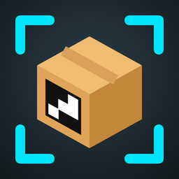
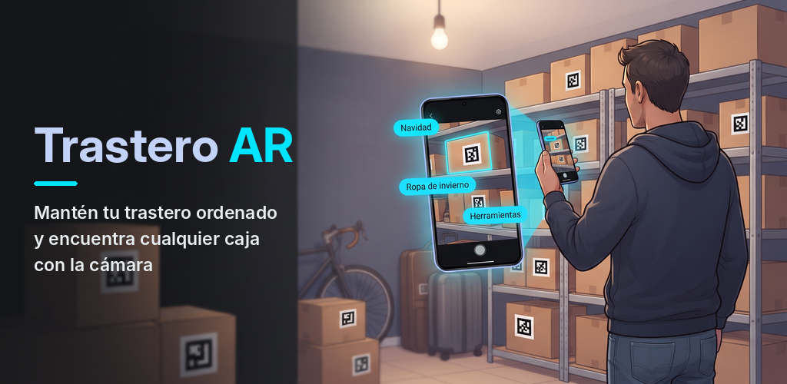
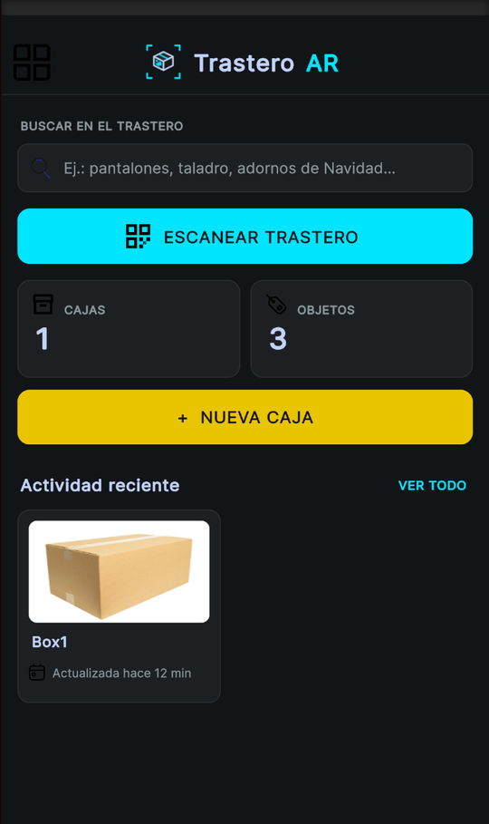
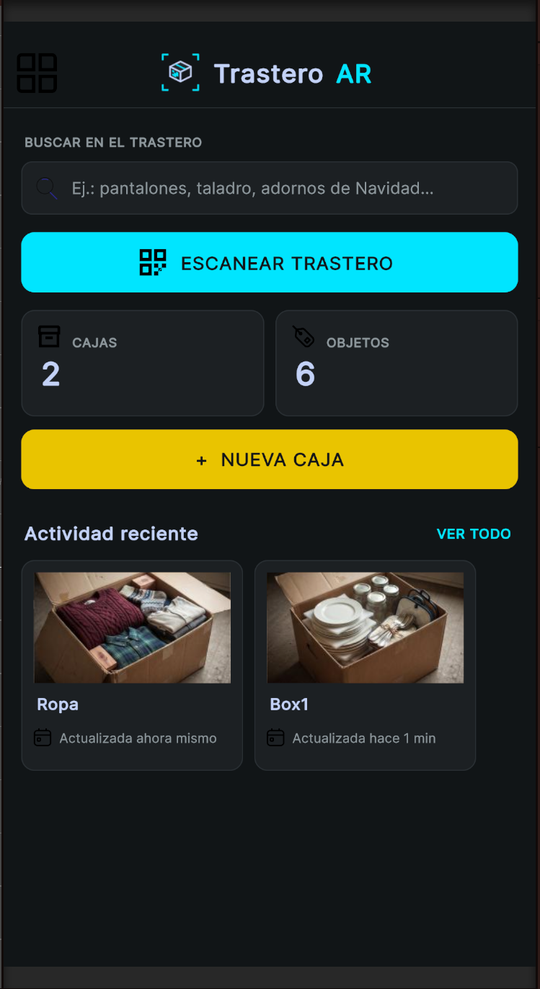
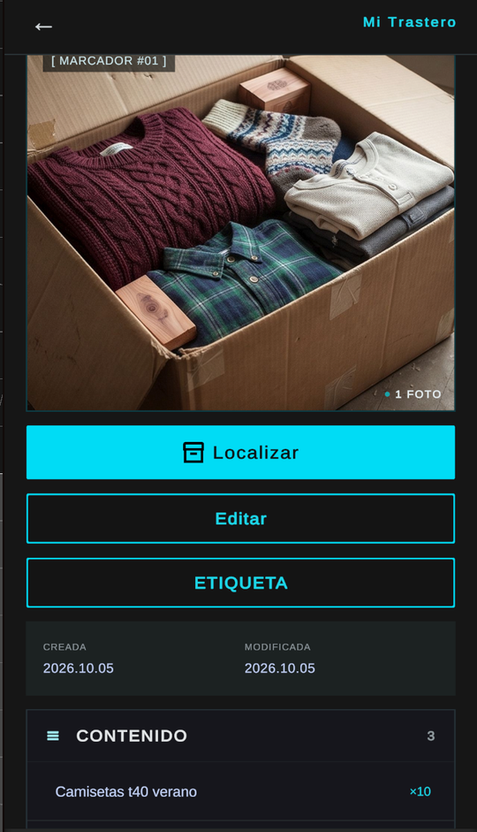
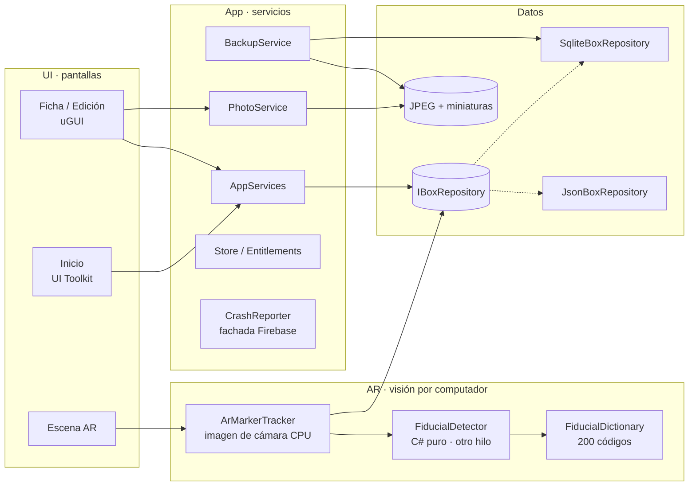
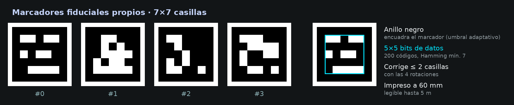

<div align="center">



# Trastero AR

**Inventario de cajas con realidad aumentada para Android.**
Apunta con el móvil al trastero y cada caja te dice lo que guarda.

[](https://rigelchuliao.github.io/trasteroar-privacidad/)
[](https://play.google.com/store/apps/details?id=com.wezen.trasteroar&hl=es_419)




</div>

> **EN ·** Trastero AR is an Android app (Unity 6 + AR Foundation/ARCore, C#) that inventories storage and moving boxes and finds them with augmented reality. Each box gets a printable label with a **custom fiducial marker** detected by my own computer-vision pipeline (pure C#, background thread), readable from **5 metres** with a 60 mm label, where ARCore image tracking failed past 60 cm. Fully offline (SQLite), with in-app purchases, backups and privacy-first crash reporting. **Published on Google Play.** Source code is private (available on request for interviews).

---

## ¿Qué hace?

Cuando tienes 30 cajas apiladas en un trastero (o a medio deshacer una mudanza), saber en cuál están los adornos de Navidad significa abrirlas todas. Trastero AR lo resuelve en tres pasos:

1. **Registras la caja**: nombre, ubicación (estantería, balda, habitación de destino…), fotos y la lista de objetos que contiene.
2. **Imprimes su etiqueta**: la app genera un PDF a tamaño real con un marcador único y la pegas en la caja.
3. **La encuentras con la cámara**: buscas «taladro», pulsas **Localizar** y, al apuntar al trastero, la caja correcta se marca en rojo. Las demás muestran un cartel flotante con su contenido; al tocarlo se abre la ficha.

<div align="center">

&nbsp;&nbsp;

&nbsp;&nbsp;

</div>

<!-- Añadir aquí un GIF o captura de la cámara AR con los carteles flotando:
<div align="center"></div>
-->

### Funciones

| | |
|---|---|
| 🔎 **Búsqueda sin acentos** | Busca en nombres de caja **y** en los objetos de dentro («camara» encuentra «Cámara»). |
| 📷 **Fotos por caja** | Cámara o galería, galería deslizable en la ficha y visor a pantalla completa. |
| 🏷️ **Etiquetas imprimibles** | PDF de una página a tamaño físico exacto (100×94 mm) con marcador, número, nombre y regla de calibración. |
| 🥽 **Localizar en AR** | Detección de hasta 200 marcadores distintos, carteles que no se solapan y la caja buscada resaltada. |
| 💾 **Copia de seguridad** | Exporta todo (base de datos + fotos) a un ZIP y lo importa en otro móvil. |
| 🌐 **Español e inglés** | Selector de idioma (automático / ES / EN). |
| 🔒 **100 % offline** | Sin cuentas ni anuncios. Los datos no salen del móvil. |
| 💳 **Freemium** | Plan gratuito y ampliaciones de pago único a 50 y 200 cajas (Google Play Billing). |

---

## Arquitectura técnica

### Stack

| Área | Tecnología |
|---|---|
| Motor | Unity 6 (6000.4) · URP · IL2CPP · ARM64 · Android 7.1+ (API 25) |
| Realidad aumentada | AR Foundation 6.6 + ARCore (cámara y pose del dispositivo) · **detector fiducial propio** |
| Persistencia | SQLite (`sqlite-net`, modo WAL) con *fallback* automático a JSON · fotos JPEG en disco |
| Interfaz | UI Toolkit (inicio, menús, listados) + uGUI/TextMesh Pro (ficha, edición, AR) |
| Plataforma | NativeCamera, NativeGallery, NativeShare, NativeFilePicker |
| Negocio | Unity IAP 5 (Google Play Billing), productos no consumibles |
| Calidad | Firebase Crashlytics (solo fallos, sin analítica) · Unity Test Framework |

Unas **13 000 líneas de C#** propias repartidas en ensamblados separados (`Runtime`, `Editor`, `Tests`).

### Capas



- **Dominio** (`Box`, `BoxItem`, `BoxPhoto`) sin dependencias de Unity.
- **Repositorio por interfaz**: toda la app habla con `IBoxRepository`. Si SQLite no arranca en un dispositivo, `AppServices` cambia a la implementación JSON sin que el resto se entere.
- **Una sola puerta a Firebase**: ningún script toca el SDK salvo `CrashReporter`, lo que permite apagarlo desde un interruptor del usuario y compilar sin Firebase en el editor.

### El reto principal: reconocer cajas a 5 metros

El primer prototipo usaba el *Image Tracking* de ARCore. Con una etiqueta de 68 mm **dejaba de reconocerla a ~60 cm**: inútil en un trastero de verdad. En lugar de agrandar las etiquetas, diseñé un sistema de marcadores propio y un detector desde cero.



**Diccionario** (`FiducialDictionary`): 200 códigos de 25 bits generados por búsqueda voraz con semilla fija, con **distancia de Hamming mínima 7** entre cualquier par contando las cuatro rotaciones. Eso permite corregir hasta 2 casillas mal leídas sin confundir una caja con otra y saber hacia dónde está girada la etiqueta.

**Detector** (`FiducialDetector`, ~750 líneas, C# puro sin Unity):

1. **Umbral adaptativo** con imagen integral: un píxel es «oscuro» si lo es respecto a su entorno, así el anillo negro sigue cerrado aunque la luz del trastero no sea uniforme.
2. **Componentes conexas** por tramos horizontales con *union-find*.
3. **Envolvente convexa** de cada componente → cuadrilátero de área máxima.
4. **Homografía** cuadrado unidad → cuadrilátero y muestreo de las 7×7 casillas.
5. **Validación**: anillo exterior negro + código con ≤ 2 errores en alguna rotación.

**Integración en tiempo real** (`ArMarkerTracker`):

- Lee el plano Y (luminancia) de la imagen de cámara de ARCore **fila a fila respetando el `rowStride`** (las filas traen relleno; copiarlas de golpe daba una imagen rayada) y la limita a 1920 px.
- La detección corre en un **hilo aparte** sin reservar memoria por fotograma; el hilo principal solo recoge resultados. Las excepciones del hilo se capturan al recoger la `Task` y se reportan.
- Proyecta las esquinas a la pantalla, coloca carteles tocables y **resuelve solapes** entre ellos; si el marcador se pierde un momento, el cartel se queda en su última posición.

**Resultado verificado en dispositivo: lectura a 5 m con luz media**, etiqueta de 60 mm con 8 mm de margen blanco.

### Otras decisiones que me gustan

- **PDF a tamaño real escrito a mano** (`MinimalPdf`): un PNG no lleva tamaño físico, así que cada impresora lo escalaba a su manera. Genero un PDF de una página con el JPEG incrustado a milímetros exactos, sin librerías externas.
- **Copia de seguridad transaccional** (`BackupService`): checkpoint del WAL antes de copiar, ZIP con manifiesto versionado, importación que descomprime en caché, filtra entradas desconocidas, **protege contra *path traversal*** (`../`), rechaza esquemas más nuevos y, si la base importada no abre, **restaura automáticamente** lo anterior.
- **Fotos consistentes**: JPEG a 1600 px + miniatura de 256 px, la BD guarda rutas relativas (las copias funcionan en otro móvil), orientación EXIF aplicada y barrido de huérfanos al arrancar.
- **Memoria acotada**: la galería carga a resolución completa solo la foto visible y sus vecinas; las texturas se destruyen al ocultar cada vista.
- **Compras robustas**: flujo pendiente → conceder y guardar → confirmar, caché local del nivel para funcionar sin red y botón «Restaurar compras». Perder el nivel nunca borra datos.
- **Privacidad por diseño**: Crashlytics envía solo fallos técnicos con mensajes en español y migas de nombres fijos; nunca nombres, textos ni fotos. Analytics y el ID de publicidad se desactivan desde un `AndroidManifest` propio.
- **Herramientas de editor**: la escena AR y sus prefabs se **generan por código** (`ArSceneBuilder`), y un menú de *release* aplica icono, versión, configuración de Crashlytics/símbolos y capturas para la ficha.

### Pruebas

- **Repositorio**: batería de pruebas EditMode que se ejecuta **contra las dos implementaciones** (SQLite y JSON): persistencia, marcador único, búsqueda sin acentos, borrado en cascada, 50 cajas…
- **Localización**: sin claves duplicadas y todas con español e inglés.
- **En dispositivo**: *checkpoints* manuales por fase (alcance AR, exportar/importar, compras con licencias de prueba) y prueba cerrada en Google Play con testers reales.

### Estructura

```
Assets/_Project/
├── Scripts/
│   ├── Domain/   modelos (Box, BoxItem, BoxPhoto) y normalización de texto
│   ├── Data/     IBoxRepository, SQLite, JSON, almacén de fotos
│   ├── App/      servicios: fotos, copias, compras, Crashlytics, idiomas, navegación
│   ├── AR/       detector fiducial, tracker de cámara, carteles y escena AR
│   ├── Labels/   diccionario de marcadores, etiqueta imprimible, PDF
│   └── UI/       pantallas (UI Toolkit + uGUI)
├── Editor/       generadores de escena y herramientas de release
└── Tests/        pruebas EditMode
```

---

## Ciclo de producto

No es solo un prototipo: la app está **publicada en Google Play** y pasó por todo el proceso real de un producto.

- Prueba cerrada con testers, informe previo al lanzamiento y Android vitals.
- Ficha en español e inglés, política de privacidad publicada y declaración de seguridad de datos coherente con lo que hace la app.
- Firma con Play App Signing, AAB y subida de símbolos IL2CPP para trazas legibles.
- Monetización sin anuncios ni suscripciones.

## Código fuente

El código es privado porque la app está a la venta en Google Play. Puedo enseñarlo y explicarlo en una entrevista técnica.

## Autor

**Rigel Chulia Ortega** · desarrollo, diseño de la interfaz, visión por computador y publicación.

[LinkedIn](https://www.linkedin.com/in/TU-PERFIL) · rigelchuliawezen@gmail.com

<sub>© 2026 Rigel Chulia Ortega. Todos los derechos reservados. La política de privacidad de la app se publica desde este repositorio: <a href="https://rigelchuliao.github.io/trasteroar-privacidad/">rigelchuliao.github.io/trasteroar-privacidad</a>.</sub>
